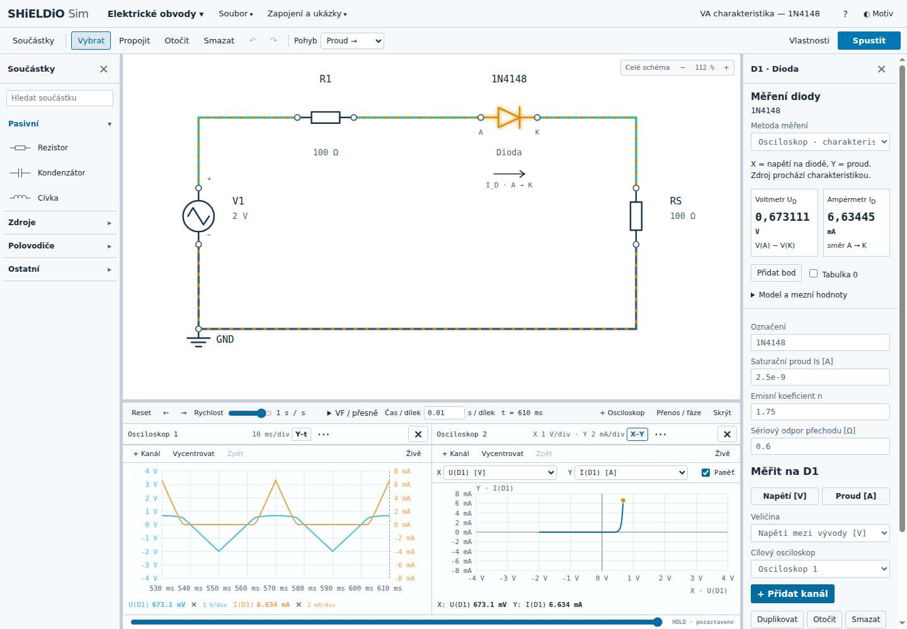
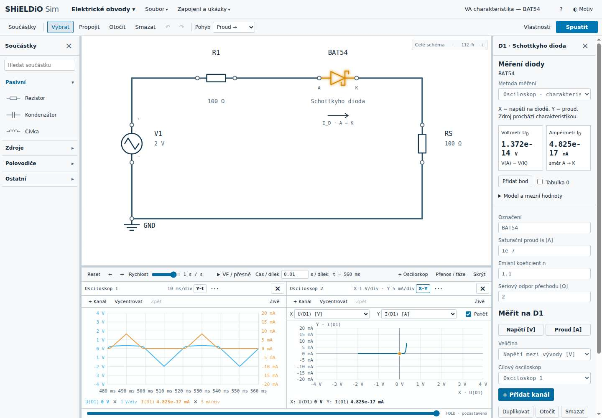
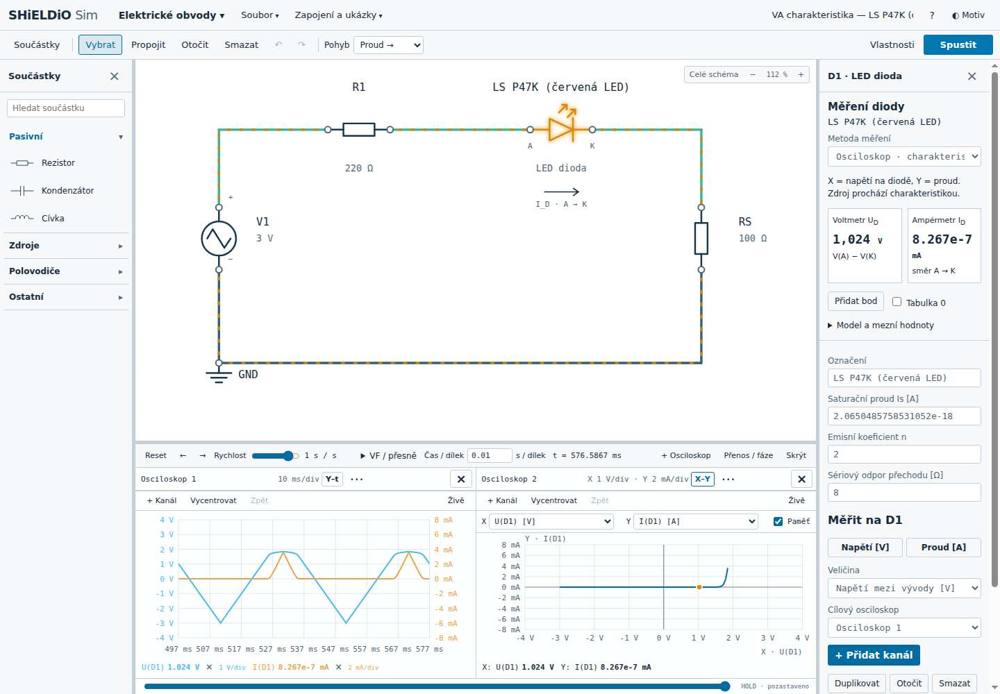
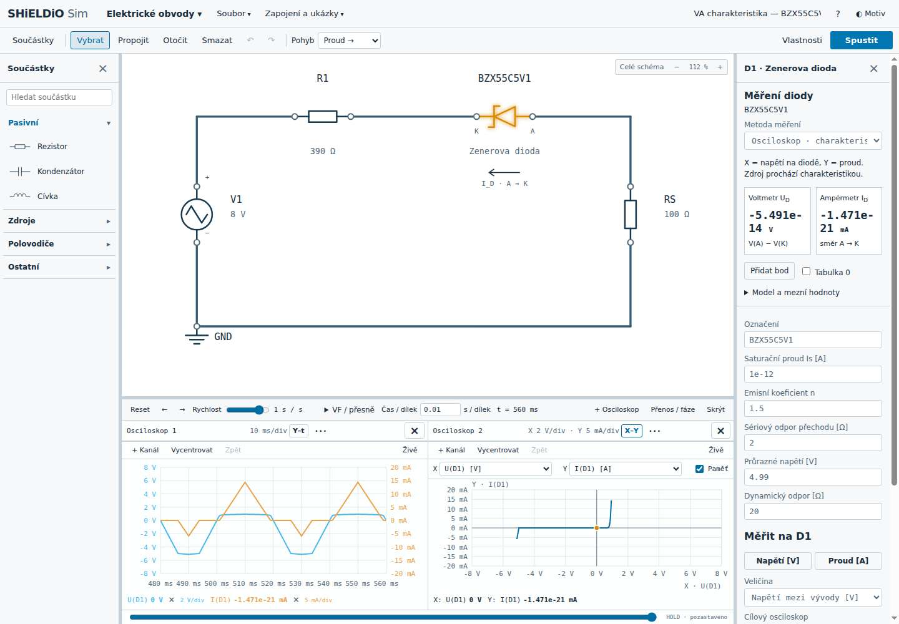

# SHiELDiO Sim — podklady pro školní demo

Verze 0.5.0-beta, 22. října 2026. Všechna data jsou **výsledky simulace**, nikoli naměřené katalogové charakteristiky.

| Součástka | Připravený obvod | Zdroj / frekvence | R1 / RS | Ukázková tabulka |
|---|---|---|---|---|
| 1N4148 | [Otevřít](https://simulation.shieldio.cz/?example=diode-iv-silicon) | ±2 V / 25 Hz | 100 Ω / 100 Ω | [CSV](1n4148.csv) |
| BAT54 | [Otevřít](https://simulation.shieldio.cz/?example=diode-iv-schottky) | ±2 V / 25 Hz | 100 Ω / 100 Ω | [CSV](bat54.csv) |
| Červená LED ams OSRAM LS P47K | [Otevřít](https://simulation.shieldio.cz/?example=diode-iv-led) | ±3 V / 25 Hz | 220 Ω / 100 Ω | [CSV](ls-p47k.csv) |
| BZX55C5V1 | [Otevřít](https://simulation.shieldio.cz/?example=diode-iv-zener) | ±8 V / 25 Hz | 390 Ω / 100 Ω | [CSV](bzx55c5v1.csv) |

CSV obsahují 41 vypočtených bodů jedné 40ms periody. Zdroj má trojúhelníkový průběh. Parametry lze měnit přímo ve schématu. Zenerova dioda má katodu vlevo ke zdroji.

## Měření a ovládání

V pravém panelu vyberte **Osciloskop** nebo **Voltmetr a ampérmetr · DC body**. U přístrojů nastavte napětí a krok ΔU, použijte **Přidat bod** a otevřete **Tabulku**. Lze přidat vzorky z průběžného záznamu a exportovat vlastní CSV. Uložené body se zachovají v souboru zapojení.

První osciloskop obsahuje U_D(t) modře a I_D(t) oranžově; druhý ukazuje synchronní páry U_D/I_D v režimu X–Y. Při 25 Hz je perioda 40 ms. Časová základna 10 ms/dílek a osm vodorovných dílků zobrazí dvě periody. Čas roste souvisle; Reset je výslovná akce.

Každý osciloskop má **Vycentrovat**, **Zpět** a **Živě**. Zpět obnoví předchozí posun a přiblížení bez vracení elektrického stavu. Ruční přiblížení a posun pozastaví běh, takže při prohlížení záznam neujíždí. Živě obnoví průběžnou simulaci. Citlivost a nula každého kanálu jsou v nabídce **⋯ → Kanály / měřítka / trigger**. Mřížka má osm dílků na obou osách; přiblížení používá řadu 1–2–5 a ukazuje skutečné V/div a mA/div. Citlivost se při změně zdroje automaticky nemění. Pro nové přizpůsobení slouží Auto měřítka.

**VF / přesně → 1 perioda za sekundu** nastaví rychlost podle frekvence zdroje a vhodné časové okno. Ručně lze nastavit 10⁻¹² až 100 simulačních sekund za skutečnou sekundu. Frekvence signálu se zpomalením nemění.

Zkratky: R rezistor, C kondenzátor, L cívka, D dioda, V DC zdroj, A AC zdroj, I proudový zdroj, G zem, O OZ, S spínač. Q výběr, W propojit, Shift+R otočit, Esc zrušit, Delete smazat, mezerník běh/pauza. Vodič lze vytvořit jedním tahem včetně ohybu; Shift mění směr ohybu. Připojený konec doprostřed vodiče vytvoří skutečný uzel a tečku. Pouhé překřížení tras zůstává nespojené.

## Model a kontrola znamének

Propustná větev používá Shockleyho přechod se sériovým odporem:

`I_D = I_S · [exp((U_D − I_D r_s)/(n · 25,85 mV)) − 1]`.

Rovnice se řeší implicitně spolu s celým obvodem; je přidána malá numerická svodová vodivost. Sériový odpor dává konečný sklon při vyšším proudu. Model Zenerovy diody přidává závěrnou průraznou větev s konečným dynamickým odporem a přibližně −5,10 V při −5 mA. Parametry představují výukové aproximace při 25 °C, nikoli modely výrobce ani přesné kopie katalogových grafů.

`U_D = V_A − V_K`; proud je vždy kladný A → K. U běžné orientace `I_D = U_RS/RS`; u obrácené Zenerovy diody `I_D = −U_RS/RS`. Její závěrný průraz proto leží v záporném napětí i proudu. Tabulka, kurzor i oba režimy grafu čtou stejné uzlové a proudové vzorky. CSV má sloupce t_ms, US_V, UD_V, URS_V, ID_mA, VA_V, VK_V.

KVL kontrola: běžná dioda `U_S = U_D + I_D(R1+RS)`; obrácená Zenerova dioda `U_S = −U_D − I_D(R1+RS)`. Největší numerická odchylka ve výchozích příkladech je menší než 10⁻¹² V.

| Výchozí příklad | Propustná špička modelu | Pozorování |
|---|---:|---|
| 1N4148 | 6,634 mA | U_D přibližně 0,673 V při špičce zdroje |
| BAT54 | 8,306 mA | U_D přibližně 0,339 V; větev vlevo od 1N4148 |
| LS P47K | 3,614 mA | U_D přibližně 1,844 V; větev výrazně vpravo |
| BZX55C5V1 | 14,417 mA v propustném směru | V závěru přibližně −5,119 V a −5,879 mA |

Změna R1 nebo amplitudy mění dosažený proud a rozsah průchodu charakteristikou, nikoli vlastní model diody. Překročení katalogových limitů vyvolává upozornění. Výchozí LED zůstává pod dovoleným proudem i závěrným napětím. Uzavřený obvod může používat automatickou numerickou referenci bez vložené země; napětí součástek zůstávají rozdílová.

## Snímky skutečné aplikace

### 1N4148

### BAT54

### Červená LED LS P47K

### BZX55C5V1

## Ověření a známá omezení

Prošlo **130 automatických testů**. Kontrola zahrnuje analogové a číslicové výpočty, integraci ngspice, znaménka a KVL, exporty, fyzické dílky os, přiblížení po delším běhu, historii pohledů a centrování. Uživatelské postupy byly ověřovány v Chrome 155, Firefoxu 157 a WebKitu 27.2 na Linuxu: všechny čtyři diody, Worker a produkční CSP, dvě časové stopy, X–Y, běh/pauza, DC přístroje a společná tabulka. Chrome navíc ověřuje PNG/CSV, motivy, rozložení, číslicové vstupy, FBD, zkratku R a tažení odbočky do existujícího vodiče. WebKit je testovaný engine, nikoli konkrétní instalace Safari na macOS/iOS. Edge nebyl samostatně testován.

Modely nepočítají samohřev, poškození, kapacity přechodů, zotavení diod, parazity pouzdra, přenosová vedení ani zatěžování skutečnými přístroji. Přístroje jsou ideální. Časová analýza používá zpětný Eulerův krok. GHz ovládání umožňuje prohlížet ideální soustředěné modely; nejde o validovaný RF simulátor skutečné desky. Průběžný buffer uchovává nejvýše 12 000 vzorků; starší body je potřeba uložit do tabulky nebo exportovat.

Wienův článek ověřuje analytický test: při f₀ = 1/(2πRC) má přenos 1/3 a při 10f₀ přibližně 0,0967. Pevné svislé měřítko již tuto změnu amplitudy neschovává.

## Katalogové podklady

- [Vishay 1N4148](https://www.vishay.com/docs/81857/1n4148.pdf)
- [Diodes Incorporated BAT54A](https://www.diodes.com/datasheet/download/BAT54A.pdf), [oficiální produktová stránka](https://www.diodes.com/part/view/BAT54A). Model představuje jeden přechod rodiny BAT54, nikoli celé dvojité pouzdro BAT54A.
- [ams OSRAM LS P47K](https://look.ams-osram.com/m/47160da8cb4b3a4a/original/LS-P47K.pdf)
- [Vishay BZX55](https://www.vishay.com/docs/85604/bzx55.pdf)
